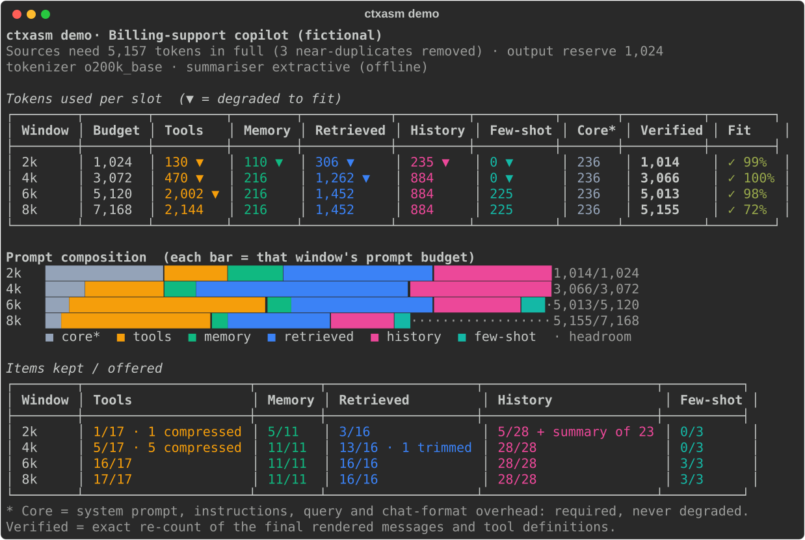
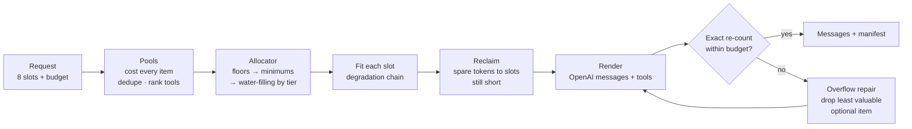
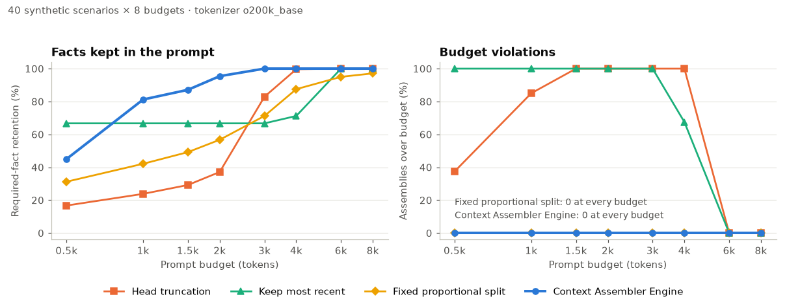
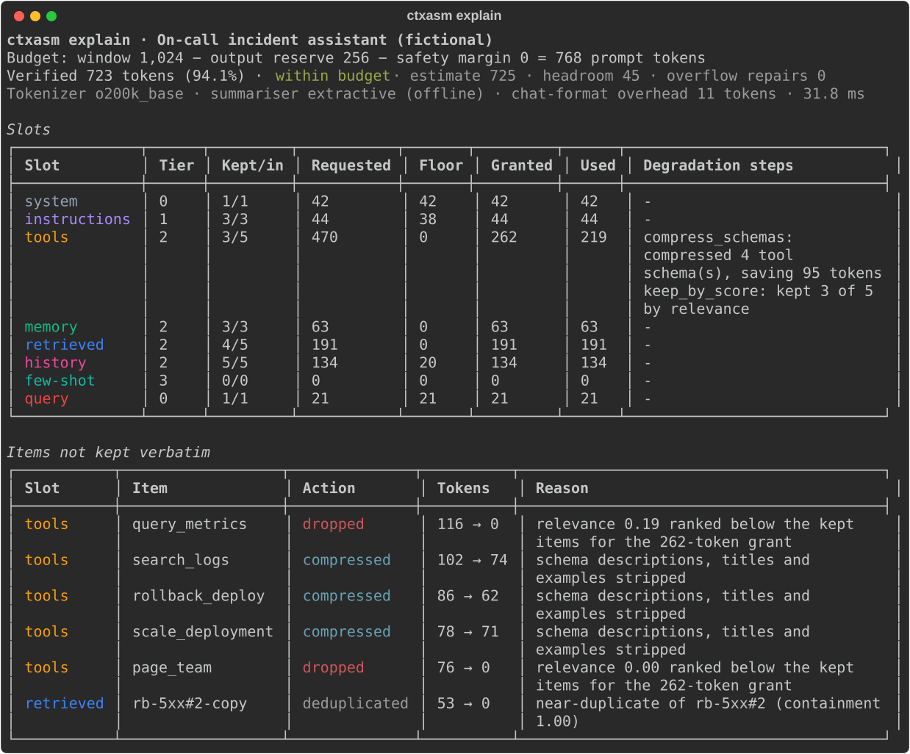

<p align="center">
  
</p>

<p align="center">
  <a href="https://github.com/iamsammy-ak/context-assembler-engine/actions/workflows/ci.yml"></a>
  
  
  
  <a href="LICENSE"></a>
</p>

**Context Assembler Engine** builds the prompt for a large language model (LLM) from many sources (system
prompt, instructions, tool schemas, memory, retrieved documents, conversation history, few-shot examples and
the user's query) under a hard token budget. It decides how many tokens each source gets, degrades content
gracefully when space runs out (summarise, compress, trim, then drop), verifies the final prompt with the real
tokenizer, and writes a manifest explaining every decision.

The guarantee is simple to state and tested hard: **the rendered prompt never exceeds the budget**, and the
engine only refuses when the required items alone cannot fit.



## Why this exists

A model's context window is shared by everything you send and everything it writes back. Real applications
send a lot: a dozen tool schemas, retrieved help articles, a long conversation, memories about the user. The
usual ways of keeping that under the limit are blunt. Cutting the prompt at the token limit silently removes
whatever comes last, which is often the user's question. Keeping only recent turns forgets facts the user gave
twenty messages ago. Fixed percentages per source waste space when one source is small and starve another when
it is large. And counting only the raw text ignores the tokens the chat format itself adds, so prompts that
"fit" can still be rejected.

This engine treats the context window as a budget to be allocated: it knows what each source needs, what is
required, what can be shortened and how, and it proves the result fits.

## Features

| | |
|---|---|
| 🧮 **Exact token accounting** | tiktoken (`o200k_base` default, `cl100k_base` option) with a count cache; per-message and tool-definition overhead counted, not just raw text |
| 🗂️ **Eight slots, one policy each** | priority tier, required flag, minimum and maximum share, weight and a degradation chain per source, all overridable |
| 💧 **Water-filling allocator** | output reserve first, then required floors, minimum shares, and priority tiers filled by weight up to their caps |
| 🪜 **Graceful degradation** | history: summarise oldest → drop oldest; retrieved: knapsack by value density → sentence-boundary trim; tools: top-k by relevance → strip descriptions → drop; memory: keep by importance |
| ✅ **Verified fit** | the final messages and tools are re-counted with the tokenizer; a deterministic repair loop fixes any estimate error |
| 🧹 **Near-duplicate removal** | word shingles with Jaccard similarity plus a containment test for truncated copies |
| 🎯 **Lost-in-the-middle ordering** | strongest retrieved evidence at the start and end of the block, weakest in the middle |
| 🧾 **Explain report** | per slot requested vs granted vs used tokens; every item kept, compressed, trimmed, summarised, deduplicated or dropped, with the reason |
| 🖥️ **CLI** | `ctxasm demo`, `ctxasm assemble spec.yaml`, `ctxasm explain spec.yaml`, `ctxasm models` |
| 📊 **Reproducible benchmark** | seeded synthetic scenarios with labelled facts; four strategies across a budget sweep |

## How it works



1. **Budget.** `prompt budget = context window − output reserve − safety margin`. A configurable model registry
   holds context windows and default reserves; the built-in profiles are labelled illustrative, and you register
   the figures from your own provider.
2. **Pools.** Every item is priced with the exact string it will be rendered as (bullet, citation prefix,
   per-message overhead). Near-duplicate chunks and memories are removed, and tools are scored against the query
   with BM25, a classic keyword-relevance formula.
3. **Allocate.** Required items (system prompt, query, pinned turns, required instructions or tools) get their
   floor first. If the floors alone do not fit, the engine renders the required-only prompt and raises
   `BudgetExceededError` only if that really is over budget. The rest is shared out: minimum shares tier by tier,
   then each tier is water-filled by weight up to `min(demand, max_share × budget)`. Caps are relaxed only if
   tokens would otherwise go unused.
4. **Fit.** Each slot walks its degradation chain until it fits its grant. Within a slot, items are chosen by
   value per token (a greedy knapsack with a best-single-item safeguard), by importance, by relevance or by
   recency, depending on the slot.
5. **Reclaim.** Tokens a slot could not use because items come in whole pieces are offered to slots that still
   left content out, highest priority first.
6. **Render and verify.** The kept items become an OpenAI-style `messages` list (system → few-shot → history →
   retrieved context + question) and a `tools` list. The whole prompt is re-counted with the tokenizer, cache
   bypassed. Byte-pair encodings are not additive (`".\n"` is one token, not two), so estimates can be off by a
   few tokens; if the count is over budget, the least valuable optional item of the lowest-priority slot is
   removed and the prompt re-counted, deterministically, until it fits.

### Default slot policies

| Slot | Tier | Min / max share | Weight | Degradation chain |
|---|---:|---|---:|---|
| system, query | 0 | required | – | never degraded |
| instructions | 1 | 0 / 15% | 1 | keep by priority (required ones always) |
| tools | 2 | 5% / 25% | 1 | top-k by relevance → compress schemas → keep by relevance |
| memory | 2 | 5% / 20% | 1 | dedupe → keep by importance |
| retrieved | 2 | 10% / 50% | 3 | dedupe → knapsack by score² per token → trim to a sentence boundary; edges ordering |
| history | 2 | 10% / 40% | 2 | summarise oldest turns → drop oldest (pinned turns stay) |
| few-shot | 3 | 0 / 15% | 1 | keep by score |

Shares are fractions of the allocatable prompt budget. Override any field per request:
`policies: {retrieved: {weight: 4, max_share: 0.6}}`.

## Benchmarks



40 seeded **synthetic** support conversations (4,746 to 5,492 tokens each) with six labelled facts planted where
an assistant would need them: an account number early in the history, a serial number near the end, a loyalty
code in memory, a policy code in a top-ranked chunk, a label reference in a middle-ranked chunk, and the tool the
query needs. Each scenario is assembled at eight prompt budgets from 512 to 8,192 tokens (1,280 assemblies).
The engine is not told where the facts are, and distractor identifiers, near-duplicates and noisy scores are
included on purpose.

| Strategy | Fact retention | Query kept | Budget violations | Mean wasted tokens | Latency p50 / p95 |
|---|---:|---:|---:|---:|---:|
| Head truncation | 61.1% | 25.0% | 209 / 320 | 3 | 10.6 / 41.7 ms |
| Keep most recent | 75.6% | 100.0% | 227 / 320 | 1 | 11.0 / 41.5 ms |
| Fixed proportional split | 66.2% | 100.0% | 0 / 320 | 902 | 8.2 / 39.0 ms |
| **Context Assembler Engine** | **88.6%** | **100.0%** | **0 / 320** | **8** | 37.6 / 108.5 ms |

| Prompt budget | 512 | 1,024 | 2,048 | 3,072 | 4,096 | 8,192 |
|---|---:|---:|---:|---:|---:|---:|
| Engine fact retention | 45.0% | 81.2% | 95.4% | 100% | 100% | 100% |
| Fixed split fact retention | 31.2% | 42.1% | 56.7% | 71.2% | 87.5% | 97.1% |

```bash
PYTHONPATH=src python benchmarks/run_benchmark.py      # a few minutes; writes benchmarks/results/
```

Full tables (per budget, per fact location, estimate accuracy) are in
[benchmarks/results/benchmark.md](benchmarks/results/benchmark.md), raw numbers in
[benchmark.json](benchmarks/results/benchmark.json).

How to read it:

- **Violations** are measured by re-counting each strategy's rendered prompt with `o200k_base` and the same
  chat-format overhead. The baselines count the way their simple versions usually do: head truncation counts
  text but not per-message overhead, keep-most-recent only budgets the history, the fixed split never
  re-verifies. Keep-most-recent's 67% retention at the smallest budgets is bought by sending prompts up to
  several thousand tokens over budget.
- **Wasted tokens** is budget left unused while content was being dropped. The fixed split loses on retention
  *and* leaves about 900 tokens unused on average because one source's unused share is never handed on.
- The engine's estimates were 2 to 3 tokens above the verified count in every assembly, so the overflow repair
  loop never had to run here; property tests with a deliberately non-additive tokenizer exercise it instead.
- Where the engine loses facts: at 512 tokens there is room for little beyond the required items, and the fact
  in the middle-ranked chunk survives 63% of the time because lower-ranked chunks are the first to go.
- Latency was measured on a shared Windows laptop with the CPU fully loaded by other work. The engine does more
  (deduplication, BM25, summarisation, a final exact re-count), so compare strategies with each other rather
  than reading the milliseconds as a hardware benchmark.

## Quick start

```bash
git clone https://github.com/iamsammy-ak/context-assembler-engine.git
cd context-assembler-engine
python -m venv .venv
source .venv/bin/activate          # Windows: .venv\Scripts\activate
pip install -e ".[dev]"

ctxasm demo                                       # the screenshot above, offline
ctxasm explain examples/incident_assistant.yaml   # per-slot grants and every item's fate
ctxasm assemble examples/incident_assistant.yaml --budget 500 -o prompt.json
ctxasm models --models-file examples/custom_models.yaml
```

Without installing, `PYTHONPATH=src python -m context_assembler demo` runs the same CLI.



Everything runs offline. tiktoken downloads its encoding file once on first use (cached afterwards; set
`TIKTOKEN_CACHE_DIR` to choose where). Optionally, copy `.env.example` to `.env` and add an
[OpenRouter](https://openrouter.ai/keys) key: `assemble` and `explain` then summarise old history with a model
instead of the extractive summariser (`--offline` turns that off). The demo always stays offline.

| Variable | Purpose |
|---|---|
| `OPENROUTER_API_KEY` | Enables the optional LLM history summariser |
| `OPENROUTER_MODELS` | Optional comma-separated model list, tried in order |
| `CTXASM_MODELS_FILE` | Extra model profiles for the CLI (YAML or JSON) |

## Use it as a library

```python
from context_assembler import AssemblyRequest, Budget, ContextAssembler, ContextItem, SlotKind, Turn

chunks = [
    ("kb-refunds", "Duplicate charges are refunded in full to the original card.", 0.91),
    ("kb-timing", "Card refunds take 5 to 10 business days to appear on a statement.", 0.74),
    ("kb-sso", "Single sign-on is available on the Enterprise plan.", 0.22),
]
request = AssemblyRequest(
    budget=Budget(context_window=4096, output_reserve=1024),
    system="You are a billing support assistant. Be exact about amounts.",
    instructions=[ContextItem(id="cite", text="Cite sources by id.", required=True)],
    memory=[ContextItem(id="card", text="Customer pays with a Visa ending 4417.", score=0.8)],
    retrieved=[ContextItem(id=cid, text=text, score=score) for cid, text, score in chunks],
    history=[
        Turn(role="user", content="I was charged EUR 249 twice this month."),
        Turn(role="assistant", content="I see INV-2291 and INV-2304; the second is a retry duplicate."),
    ],
    query="Please refund the duplicate to my card. How long will it take?",
)

result = ContextAssembler().assemble(request)  # tiktoken o200k_base by default
print(f"{result.manifest.verified_tokens}/{result.manifest.prompt_budget} tokens")  # 156/3072 tokens

# The same request squeezed into 120 prompt tokens: required items stay, the rest degrades.
small = ContextAssembler().assemble(request.with_budget(Budget.prompt_only(120)))
for decision in small.manifest.decisions:
    if decision.action != "kept":
        print(decision.slot.value, decision.item_id, decision.action, "-", decision.reason)
# retrieved kb-timing dropped - value density 26.08 per 1k tokens was below the cut for the 33-token grant
# retrieved kb-sso dropped - value density 3.23 per 1k tokens was below the cut for the 33-token grant
# history turn-1 summarised - older than the recent window; folded into the conversation summary
# history turn-2 summarised - older than the recent window; folded into the conversation summary

# Send it with any OpenAI-compatible client:
# client.chat.completions.create(model="...", **result.request_kwargs())
```

Register your own model and tune a slot:

```python
from context_assembler import ModelSpec, PolicyOverride, default_registry

registry = default_registry()
registry.register(ModelSpec(name="my-model", context_window=32_768, output_reserve=2_048))
tuned = request.model_copy(
    update={
        "budget": registry.get("my-model").budget(),
        "policies": {SlotKind.RETRIEVED: PolicyOverride(weight=5, max_share=0.7)},
    }
)
ContextAssembler().assemble(tuned).manifest.prompt_budget  # 30720
```

`ContextAssembler` also accepts any `Tokenizer` subclass (for model families tiktoken does not cover), a
`ChatFormat` with different overheads, a custom summariser, `strict_max_share=True` and `reclaim=False`.

## Design decisions

- **Verify the rendered prompt instead of trusting the sum of item counts.** Byte-pair encodings merge across
  boundaries, so per-item counts are estimates. The alternative, padding every estimate pessimistically, wastes
  budget on every call and still is not a proof. Pricing each item together with its separator keeps estimates
  within a few tokens, and an exact re-count plus a deterministic repair loop turns "usually fits" into "always
  fits".
- **Strict priority tiers, water-filling within a tier.** A single global knapsack across all slots would need
  relevance, importance and recency on one comparable value scale, which they are not, and its decisions would
  be hard to explain. Tiers make the policy explicit ("the question and system prompt first, evidence and
  history next, examples last"); weights and min/max shares tune the split inside a tier; caps relax only when
  tokens would otherwise be wasted.
- **Degradation chains rather than drop-only.** Summarising old turns, stripping tool descriptions and trimming
  a chunk at a sentence boundary keep information that dropping would lose. Each step is small, named and
  recorded in the manifest, so a surprising prompt can be traced back to a policy.
- **Greedy knapsack by value density, with score squared.** An exact dynamic-programming knapsack is affordable
  at these sizes, but greedy selection is easier to explain item by item ("its value per token was below the
  cut") and is guaranteed at least half the optimum with the best-single-item check. Plain score per token
  favours short, weak chunks; squaring the score before dividing makes one strong chunk beat several weak ones.
- **An offline extractive summariser by default, a model only if configured.** It keeps assembly deterministic,
  fast and free, which the tests and benchmark rely on. The cost is less fluent summaries; the LLM summariser is
  a drop-in replacement that falls back to the extractive one on any failure and is still hard-capped by the
  tokenizer.
- **Shingles and Jaccard for duplicates, not embeddings.** No model download and fully deterministic. Jaccard
  alone misses truncated copies of a chunk (similarity around 0.75), so a containment test catches those. It
  does not catch paraphrases, which embeddings would.

## Project structure

```
context-assembler-engine/
├── src/context_assembler/
│   ├── assembler.py        allocate → fit → reclaim → render → verify → repair; the manifest
│   ├── allocator.py        floors, minimum shares, priority water-filling
│   ├── fitting.py          per-slot degradation steps (summarise, compress, knapsack, trim, drop)
│   ├── pools.py            per-slot candidates, costs, dedupe, tool relevance
│   ├── render.py           OpenAI-style rendering and the matching cost model
│   ├── tokenizer.py        tiktoken + approximate tokenizer, count cache, chat-format overhead
│   ├── models.py           model registry (illustrative profiles, user-registered models)
│   ├── policy.py · schema.py · slots.py · manifest.py     data contracts (Pydantic v2)
│   ├── dedupe.py · ordering.py · relevance.py · tools.py · text.py
│   ├── summarise.py · llm.py   extractive summariser, optional OpenRouter summariser
│   ├── cli.py · report.py · spec.py   ctxasm CLI, Rich views, YAML/JSON specs
│   ├── data/support_copilot.yaml      demo scenario (fictional)
│   └── bench/              synthetic scenarios, baseline strategies, metrics
├── benchmarks/             run_benchmark.py and results/ (JSON + Markdown)
├── examples/               incident_assistant.yaml, custom_models.yaml, quickstart.py
├── tests/                  unit, CLI and property-based tests
└── assets/                 banner, terminal captures, benchmark chart
```

## Testing

```bash
ruff check . && mypy && pytest -q
```

110 tests run in well under a minute, offline (a fixture removes any API key). Hypothesis generates random
requests (unicode, special-token text, negative scores, pinned turns, required items, budgets from 20 to 2,500
tokens) and checks that the verified prompt never exceeds the budget, that required items and the query are
always present, that `BudgetExceededError` is raised only when the required-only prompt really is over budget,
and that assembly is deterministic. The same property runs with tiktoken, with the approximate tokenizer and
with an adversarial tokenizer whose joined text costs more than its parts, which forces the repair loop. The
allocator has its own property test (floors respected, grants within demand, sum within budget, no unused
tokens while demand remains), alongside unit tests for every degradation step, the LLM client's fallback,
cache and JSON repair (with a fake client), the spec loader and the CLI. CI runs ruff, mypy and pytest on
Python 3.10 and 3.12.

## Limitations

- tiktoken covers OpenAI-family encodings. For other model families, plug in your own `Tokenizer` or use the
  approximate one with a `safety_margin`; the guarantee holds with respect to the tokenizer you supply.
- Per-message overhead follows OpenAI's published counting recipe; tool-definition overhead is an approximation
  because providers render tools in an internal format. A safety margin covers providers that differ.
- The benchmark is synthetic. Its facts carry identifiers, and the extractive summariser gives identifiers a
  bonus, which suits this data; real conversations will be less tidy.
- Tool relevance is lexical (BM25) and retrieval scores are taken as given; synonyms the query does not share
  with a tool description are missed.
- History holds user and assistant turns only; tool-call and tool-result messages are not modelled yet.
- Near-duplicate detection compares every pair, fine for the tens to low hundreds of items a prompt holds.

## Roadmap

- [ ] Tokenizer adapters for Hugging Face tokenizers and other model families
- [ ] Optional embedding-based relevance and paraphrase-aware deduplication
- [ ] Tool-call and tool-result messages in the history slot
- [ ] Prompt-caching-aware layout that keeps a stable prefix across turns

## License

[MIT](LICENSE) © 2026 Abhishek Kumar
